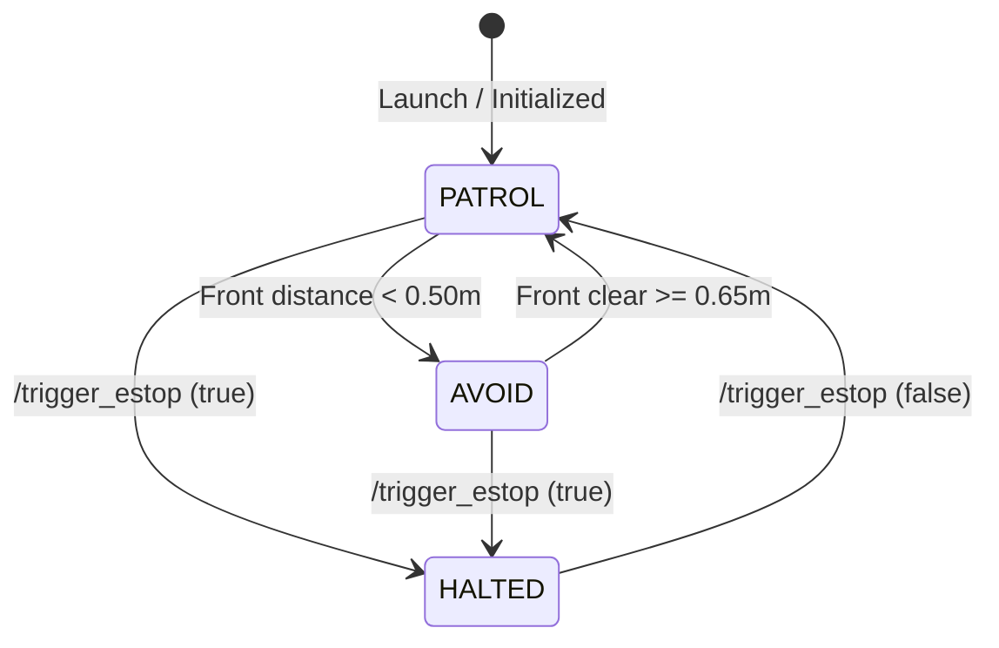
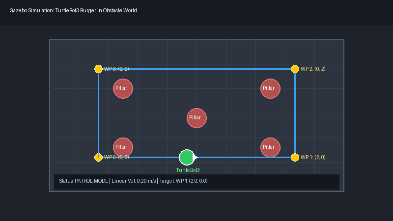
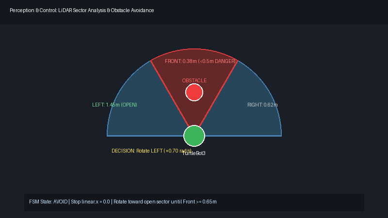
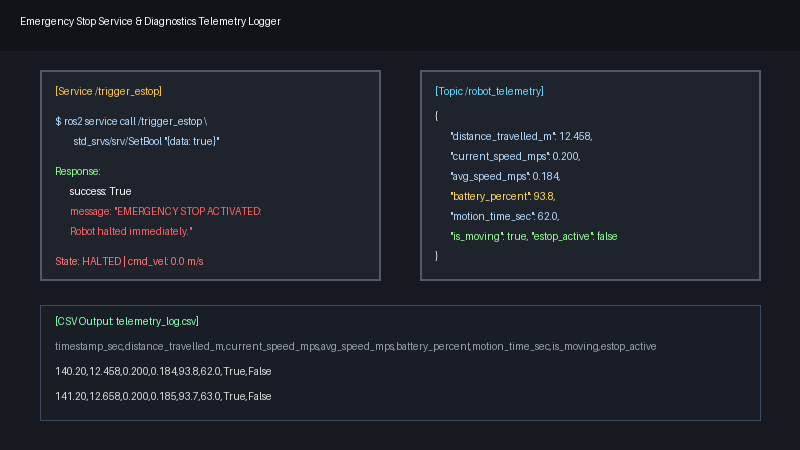

# Autonomous TurtleBot3 Patrol & Obstacle Avoidance

[](https://docs.ros.org/)
[](https://gazebosim.org/)
[](https://emanual.robotis.com/docs/en/platform/turtlebot3/overview/)
[](LICENSE)

A modular, production-ready ROS 2 software stack for a **TurtleBot3** robot operating autonomously inside a simulated Gazebo environment. The system executes square or custom waypoint patrol, performs real-time LiDAR-based obstacle detection and evasion, responds to a safety emergency-stop service with immediate halt and resume, and monitors robot telemetry with battery discharge simulation logged to CSV.

---

## 1. System Architecture

The package follows a clean modular ROS 2 architecture partitioned into four dedicated nodes:

```mermaid
flowchart TD
    subgraph Gazebo Simulation
        SIM_SCAN["/scan (sensor_msgs/LaserScan)"]
        SIM_ODOM["/odom (nav_msgs/Odometry)"]
        SIM_CMD["/cmd_vel (geometry_msgs/Twist)"]
    end

    subgraph Perception
        LOD["lidar_obstacle_detector Node"]
        SIM_SCAN --> LOD
        LOD -->|/obstacle_status| PC["patrol_controller Node"]
        LOD -->|/obstacle_markers| RVIZ["RViz2 Visualization"]
    end

    subgraph Safety & Services
        ESTOP["emergency_stop_server Node"]
        OP["Operator / Service Client"] -->|/trigger_estop (std_srvs/SetBool)| ESTOP
        ESTOP -->|/estop_state (std_msgs/Bool)| PC
        ESTOP -->|/estop_state (std_msgs/Bool)| TL["telemetry_logger Node"]
    end

    subgraph Decision Making & Motion
        SIM_ODOM --> PC
        PC -->|/cmd_vel| SIM_CMD
        PC -->|/waypoint_markers| RVIZ
    end

    subgraph Diagnostics & Logging
        SIM_ODOM --> TL
        SIM_CMD --> TL
        TL -->|/robot_telemetry| MON["Telemetry Monitor"]
        TL --> CSV["telemetry_log.csv"]
    end
```

### Finite State Machine (FSM)

The `patrol_controller` operates on a deterministic 3-state machine:



1. **`PATROL`**: Moves along configured square coordinates or waypoints using proportional distance and heading control.
2. **`AVOID`**: Stops forward motion immediately (`linear.x = 0.0`), samples left vs right sector clearances, rotates toward the open side until the path is cleared, then resumes patrol.
3. **`HALTED`**: Instantly commands zero velocities (`linear.x = 0.0`, `angular.z = 0.0`) on E-stop. Holds state until explicitly cleared.

---

## 2. Package Structure

```text
turtlebot_patrol/
├── CMakeLists.txt / setup.py           # Package setup and entry points
├── package.xml                         # Package dependencies and manifest
├── README.md                           # Documentation, setup & testing guide
├── setup.cfg                           # Script install targets
├── config/
│   └── patrol_params.yaml              # Configurable parameters
├── docker/
│   ├── Dockerfile                      # Standalone Ubuntu 22.04 + ROS 2 Humble image
│   ├── docker-compose.yml              # Compose configuration
│   └── entrypoint.sh                   # Container entrypoint script
├── launch/
│   └── patrol_simulation.launch.py     # Unified launch file
├── resource/
│   └── turtlebot_patrol                # ament resource marker
├── rviz/
│   └── patrol.rviz                     # RViz2 configuration with markers
├── test/
│   ├── test_copyright.py               # Linter test
│   ├── test_flake8.py                  # Code style test
│   ├── test_patrol_logic.py            # Unit tests for logic and math
│   └── test_pep257.py                  # Docstring test
└── turtlebot_patrol/
    ├── __init__.py                     # Python package initializer
    ├── emergency_stop_server.py        # E-stop service & publisher node
    ├── lidar_obstacle_detector.py      # 360° LiDAR 3-sector obstacle perception
    ├── patrol_controller.py            # Waypoint patrol & evasion FSM node
    └── telemetry_logger.py             # Distance, speed, battery & CSV logger
```

---

## 3. Interfaces: Topics & Services

| Interface Name | Type | Publisher / Server | Subscriber / Client | Description |
| :--- | :--- | :--- | :--- | :--- |
| `/scan` | `sensor_msgs/msg/LaserScan` | Gazebo Simulation | `lidar_obstacle_detector` | 360° LiDAR laser scan input |
| `/obstacle_status` | `std_msgs/msg/Float32MultiArray` | `lidar_obstacle_detector` | `patrol_controller` | Array: `[front_min, left_min, right_min, obstacle_flag]` |
| `/odom` | `nav_msgs/msg/Odometry` | Gazebo Simulation | `patrol_controller`, `telemetry_logger` | Robot odometry pose & velocity |
| `/cmd_vel` | `geometry_msgs/msg/Twist` | `patrol_controller` | Gazebo Simulation, `telemetry_logger` | Linear and angular velocity commands |
| `/trigger_estop` | `std_srvs/srv/SetBool` | `emergency_stop_server` | Operator / CLI | Service to activate (`true`) or clear (`false`) E-stop |
| `/estop_state` | `std_msgs/msg/Bool` | `emergency_stop_server` | `patrol_controller`, `telemetry_logger` | Broadcasts current E-stop state at 10 Hz |
| `/robot_telemetry` | `std_msgs/msg/String` | `telemetry_logger` | Telemetry Consumers | JSON telemetry string (distance, speed, battery) |
| `/obstacle_markers` | `visualization_msgs/msg/MarkerArray` | `lidar_obstacle_detector` | RViz2 | RViz visual markers for obstacle indicator (Bonus) |
| `/waypoint_markers` | `visualization_msgs/msg/MarkerArray` | `patrol_controller` | RViz2 | Visual path lines & current target waypoint (Bonus) |

---

## 4. Installation & Build

### Prerequisites
- **Ubuntu Linux** (22.04 LTS recommended, or 24.04 LTS)
- **ROS 2** (Humble Hawksbill or Jazzy Jalisco)
- **TurtleBot3 Gazebo Packages**:
  ```bash
  sudo apt update
  sudo apt install -y \
    ros-$ROS_DISTRO-turtlebot3-gazebo \
    ros-$ROS_DISTRO-turtlebot3-msgs \
    ros-$ROS_DISTRO-turtlebot3-teleop \
    ros-$ROS_DISTRO-visualization-msgs
  ```

### Build Instructions
1. Create or navigate to your ROS 2 workspace:
   ```bash
   mkdir -p ~/ros2_ws/src
   cd ~/ros2_ws/src
   ```
2. Clone this repository into `src`:
   ```bash
   git clone https://github.com/ApoorvaTiwari07/ros-task.git turtlebot_patrol
   ```
3. Install package dependencies:
   ```bash
   cd ~/ros2_ws
   rosdep update
   rosdep install --from-paths src --ignore-src -r -y
   ```
4. Build the package with `colcon`:
   ```bash
   colcon build --symlink-install --packages-select turtlebot_patrol
   ```
5. Source the workspace overlay:
   ```bash
   source install/setup.bash
   ```

---

## 5. Running the Simulation

Set the TurtleBot3 model (e.g. `burger` or `waffle_pi`):
```bash
export TURTLEBOT3_MODEL=burger
```

Launch the complete autonomous patrol and simulation stack using the single unified launch file:
```bash
ros2 launch turtlebot_patrol patrol_simulation.launch.py
```

To enable RViz2 visualization side-by-side with Gazebo:
```bash
ros2 launch turtlebot_patrol patrol_simulation.launch.py rviz:=true
```

---

## 6. Verification & Testing

Open separate terminal tabs (ensure you have sourced `install/setup.bash` in each).

### Step 1: Verify Active Nodes & Graph
Check that all four nodes are running and communicating:
```bash
ros2 node list
```
*Expected Output:*
```text
/emergency_stop_server
/gazebo
/lidar_obstacle_detector
/patrol_controller
/telemetry_logger
```

### Step 2: Observe Autonomous Square Patrol
Watch the TurtleBot3 traverse its configured square waypoints:
`(0.0, 0.0) -> (2.0, 0.0) -> (2.0, 2.0) -> (0.0, 2.0) -> (0.0, 0.0)`
The controller automatically advances waypoints upon reaching within `0.20m`.

### Step 3: Test Obstacle Avoidance
In Gazebo, insert a cylinder or box directly in front of the robot's path:
- The `lidar_obstacle_detector` flags the obstacle when distance is `< 0.50m`.
- The robot halts forward linear motion (`linear.x = 0.0`).
- The robot evaluates left vs. right sector clearance and rotates toward the more open side.
- Once the front sector clears (`>= 0.65m`), the robot smoothly resumes patrol toward its target waypoint.

Check obstacle status topic:
```bash
ros2 topic echo /obstacle_status
```
*Output format: `data: [front_distance, left_distance, right_distance, obstacle_flag]`*

### Step 4: Test Emergency Stop Service
#### Activate E-Stop (Immediate Halt):
```bash
ros2 service call /trigger_estop std_srvs/srv/SetBool "{data: true}"
```
*Expected Response:*
```text
response:
  success: True
  message: 'EMERGENCY STOP ACTIVATED: Robot halted immediately.'
```
The robot immediately stops all motion (`cmd_vel: linear.x = 0.0, angular.z = 0.0`).

#### Clear E-Stop (Resume Patrol):
```bash
ros2 service call /trigger_estop std_srvs/srv/SetBool "{data: false}"
```
*Expected Response:*
```text
response:
  success: True
  message: 'EMERGENCY STOP CLEARED: Robot resumed normal patrol.'
```
The robot resumes its patrol trajectory toward the next target waypoint.

### Step 5: Verify Telemetry Logging & CSV Output
Echo the telemetry topic:
```bash
ros2 topic echo /robot_telemetry
```
*Sample JSON telemetry:*
```json
{
  "timestamp": 124.50,
  "distance_travelled_m": 6.842,
  "current_speed_mps": 0.200,
  "avg_speed_mps": 0.187,
  "battery_percent": 96.6,
  "motion_time_sec": 34.2,
  "is_moving": true,
  "estop_active": false
}
```

View the generated CSV log:
```bash
tail -n 10 telemetry_log.csv
```
*CSV format:*
```csv
timestamp_sec,distance_travelled_m,current_speed_mps,avg_speed_mps,battery_percent,motion_time_sec,is_moving,estop_active
124.50,6.842,0.200,0.187,96.6,34.2,True,False
```

### Step 6: Run Automated Unit Tests
```bash
colcon test --packages-select turtlebot_patrol
colcon test-result --verbose
```

---

## 7. Demonstration Images

### Image 1: Gazebo Simulation World & Patrol Route

*TurtleBot3 Burger navigating the autonomous square patrol route inside the Gazebo obstacle world.*

### Image 2: Dynamic LiDAR Obstacle Detection & Avoidance

*Front sector obstacle flagged below 0.5m threshold; robot autonomously turning toward the open clearance sector.*

### Image 3: Emergency Stop Service & Telemetry Console Output

*Terminal showing invocation of `/trigger_estop`, immediate velocity suppression, and continuous telemetry logging.*

---

## 8. Docker Deployment (Bonus / Extra Credit)

For fully reproducible execution without local ROS 2 installation, build and run via Docker:

```bash
cd docker
docker compose build
docker compose up
```

Inside the container, test E-stop in an interactive shell:
```bash
docker exec -it turtlebot_patrol_sim bash
ros2 service call /trigger_estop std_srvs/srv/SetBool "{data: true}"
```

---

## 9. Demonstration Video Recording Checklist

A 1-minute video demonstration should showcase:
1. **0:00 - 0:15**: Launching `ros2 launch turtlebot_patrol patrol_simulation.launch.py` and observing the robot patrol its square route.
2. **0:15 - 0:30**: Encountering an obstacle, front detection trigger, in-place rotation toward open space, and resumed patrol.
3. **0:30 - 0:45**: Calling `ros2 service call /trigger_estop std_srvs/srv/SetBool "{data: true}"` with immediate robot halt.
4. **0:45 - 0:55**: Calling `ros2 service call /trigger_estop std_srvs/srv/SetBool "{data: false}"` with robot resuming motion.
5. **0:55 - 1:00**: Showing `/robot_telemetry` printout and `telemetry_log.csv`.

---

## 10. Authors & License

- **Author**: Apoorva Tiwari
- **Repository**: [github.com/ApoorvaTiwari07/ros-task](https://github.com/ApoorvaTiwari07/ros-task)
- **License**: Apache License 2.0
