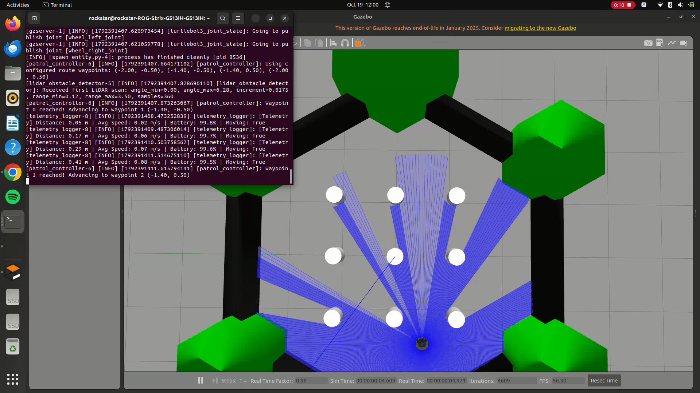
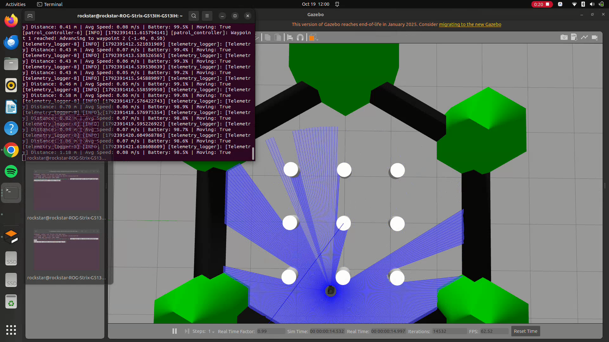
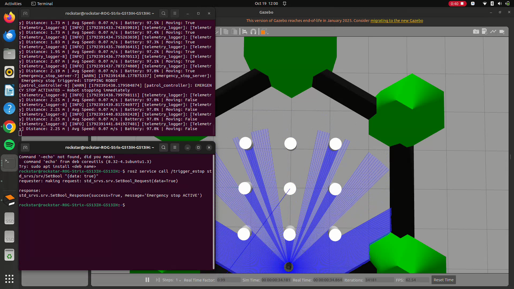

# Autonomous TurtleBot Patrol & Obstacle Avoidance

A modular ROS 2 Humble software stack for autonomous waypoint patrolling, LiDAR-based reactive obstacle avoidance, remote emergency stop management, and live telemetry logging on a simulated TurtleBot3 Burger in Gazebo Classic.

---

## 1. Project Objective

The objective of this project is to build an autonomous navigation and monitoring stack for a differential-drive robot (`TurtleBot3 Burger`) operating in an indoor environment with obstacles.

Key requirements fulfilled:
1. **Autonomous Waypoint Patrol**: Follows a predefined square or configured multi-point patrol route using filtered odometry.
2. **LiDAR Perception & Obstacle Avoidance**: Slices raw 360° laser scans into Front, Left, and Right angular sectors, normalizes angles through $2\pi$, filters out non-return / invalid readings, and turns toward the sector with greater clearance.
3. **Emergency Stop Service**: A dedicated service and state topic allowing instant stopping and safe resumption without overriding by the controller.
4. **Telemetry Logging**: Tracks total distance travelled, average linear speed, and motion-dependent simulated battery drain, publishing human-readable updates to `/robot_telemetry` and appending timestamped records to `telemetry_log.csv`.
5. **Single-Command Launch**: Starts Gazebo Classic, spawns the robot model, and launches all 4 nodes with loaded configuration via one unified launch file.

---

## 2. System Architecture

The software stack is organized into four decoupled nodes:

```
                  +---------------------------+
                  |   Gazebo Classic / Robot   |
                  +---------------------------+
                      | /scan          ^ /cmd_vel
                      v                |
      +------------------------+       |
      | lidar_obstacle_detector|       |
      +------------------------+       |
                  | /obstacle_status   |
                  v                    |
      +--------------------------------+------+
      |           patrol_controller           |
      +--------------------------------+------+
            ^ /odom              ^ /estop_state
            |                    |
+--------------------+   +-----------------------+
|  telemetry_logger  |   | emergency_stop_server |
+--------------------+   +-----------------------+
   |                        ^ /trigger_estop
   v /robot_telemetry       | (std_srvs/SetBool)
   + telemetry_log.csv
```

### Node Descriptions

1. **`lidar_obstacle_detector`**
   - **Perception layer**: Subscribes to `/scan` (`sensor_msgs/msg/LaserScan`).
   - Normalizes all ray angles from $[0, 2\pi]$ into $[-\pi, +\pi]$ so left and right sectors are assigned accurately regardless of sensor orientation.
   - Divides the scan into three sectors:
     - **Front**: $-30^\circ$ to $+30^\circ$
     - **Left**: $+30^\circ$ to $+90^\circ$
     - **Right**: $-90^\circ$ to $-30^\circ$
   - Computes the minimum valid obstacle distance per sector, filtering out `inf`, `NaN`, and sub-minimum range noise.
   - Publishes sector clearances on `/obstacle_status` as `[front, left, right]`.

2. **`patrol_controller`**
   - **Decision & motion control layer**: Implements a robust Finite-State Machine (FSM):
     - **`PATROL`**: Targets the current waypoint using proportional heading and distance control.
     - **`AVOID`**: Triggered when `front < obstacle_distance_threshold` (0.50 m). Halts linear movement and rotates toward the clearer side (comparing Left vs. Right clearance).
     - **`CLEAR`**: Once `front >= safe_resume_distance` (0.65 m hysteresis), executes a cautious forward bypass with side obstacle repulsion before resuming the waypoint heading.
     - **`RECOVERY`**: Bounded recovery maneuver (cautious reverse and alternate turn) triggered if progress stalls or avoidance times out.
     - **`BLOCKED`**: Safe zero-velocity state entered if maximum recovery attempts are exceeded without finding a clear exit.
     - **`HALTED`**: Overrides all motion when `/estop_state` is active.

3. **`emergency_stop_server`**
   - **Safety layer**: Provides the `/trigger_estop` service (`std_srvs/srv/SetBool`).
   - Periodically publishes the current state on `/estop_state` (`std_msgs/msg/Bool`) at 10 Hz.
   - Calling `data: true` immediately halts the robot; `data: false` safely releases the stop.

4. **`telemetry_logger`**
   - **Diagnostics layer**: Subscribes to `/odom` and `/cmd_vel`.
   - Calculates total Euclidean distance travelled, active average linear speed, and simulated battery consumption (starting at 100%, draining 1% per 10s of motion).
   - Publishes formatted status strings to `/robot_telemetry` (`std_msgs/msg/String`).
   - Writes periodic timestamped records to `~/robot_ws/telemetry_log.csv` with instant flushing and clean shutdown.

---

## 3. ROS 2 Interface Summary

### Topics

| Topic | Type | Publisher | Subscriber | Description |
|---|---|---|---|---|
| `/scan` | `sensor_msgs/msg/LaserScan` | Gazebo (`turtlebot3_laserscan`) | `lidar_obstacle_detector` | 360° 2D LiDAR range scan |
| `/obstacle_status` | `std_msgs/msg/Float32MultiArray` | `lidar_obstacle_detector` | `patrol_controller` | `[front, left, right]` minimum distances in meters |
| `/odom` | `nav_msgs/msg/Odometry` | Gazebo (`turtlebot3_diff_drive`) | `patrol_controller`, `telemetry_logger` | Robot odometry pose and twist |
| `/cmd_vel` | `geometry_msgs/msg/Twist` | `patrol_controller` | Gazebo (`turtlebot3_diff_drive`), `telemetry_logger` | Velocity commands |
| `/estop_state` | `std_msgs/msg/Bool` | `emergency_stop_server` | `patrol_controller` | Emergency stop status (True=halted, False=operational) |
| `/robot_telemetry` | `std_msgs/msg/String` | `telemetry_logger` | External / User | Live diagnostic summary string |

### Services

| Service | Type | Server | Description |
|---|---|---|---|
| `/trigger_estop` | `std_srvs/srv/SetBool` | `emergency_stop_server` | Set `data: true` to halt robot, `data: false` to resume |

---

## 4. Prerequisites & Installation

### Environment Requirements
- **OS**: Ubuntu 22.04 LTS
- **ROS 2**: Humble Hawksbill
- **Simulator**: Gazebo Classic 11
- **Robot Model**: TurtleBot3 Burger

### Setup & Build
```bash
# Source ROS 2 environment
source /opt/ros/humble/setup.bash

# Ensure TurtleBot3 model variable is configured
export TURTLEBOT3_MODEL=burger

# Navigate to workspace and build
cd ~/robot_ws
colcon build --packages-select turtlebot_patrol
source install/setup.bash
```

---

## 5. Execution Guide

### Single-Command Unified Launch

To start Gazebo, spawn the robot in the obstacle world, and launch all four autonomous nodes:

```bash
source /opt/ros/humble/setup.bash
source ~/robot_ws/install/setup.bash
export TURTLEBOT3_MODEL=burger
ros2 launch turtlebot_patrol patrol_simulation.launch.py
```

*To run in headless mode (without opening the Gazebo GUI window):*
```bash
ros2 launch turtlebot_patrol patrol_simulation.launch.py gui:=false
```

### Emergency Stop Controls

Open a second terminal:

**1. Activate Emergency Stop (robot halts immediately):**
```bash
ros2 service call /trigger_estop std_srvs/srv/SetBool "{data: true}"
```

**2. Release Emergency Stop (robot resumes patrolling):**
```bash
ros2 service call /trigger_estop std_srvs/srv/SetBool "{data: false}"
```

### Monitoring Telemetry

**Live topic stream:**
```bash
ros2 topic echo /robot_telemetry
```

**Check CSV log file:**
```bash
cat ~/robot_ws/telemetry_log.csv
```

---

## 6. Configuration Parameters

All parameters are located in `config/patrol_params.yaml`:

```yaml
lidar_obstacle_detector:
  ros__parameters:
    obstacle_distance_threshold: 0.38  # Calibrated detection distance (m)
    max_range: 3.5                     # Sensor range limit fallback
    front_angle_min_deg: -22.0         # Calibrated front sector for corridor clearance
    front_angle_max_deg: 22.0
    left_angle_min_deg: 22.0
    left_angle_max_deg: 90.0
    right_angle_min_deg: -90.0
    right_angle_max_deg: -22.0

patrol_controller:
  ros__parameters:
    obstacle_distance_threshold: 0.38  # Enter avoidance when front < 0.38m
    safe_resume_distance: 0.48         # Hysteresis exit: resume when front >= 0.48m
    linear_speed: 0.12                 # Patrol cruising velocity (m/s)
    angular_speed: 0.28                # Smooth turning velocity (rad/s)
    waypoint_tolerance: 0.18           # Acceptance radius per waypoint (m)
    stuck_timeout: 3.0                 # Timeout detecting zero progress
    max_recovery_attempts: 3           # Retries before safe BLOCKED state
    scan_timeout: 1.5                  # Safety watchdog timeouts
    odom_timeout: 1.5
    waypoints: [-2.0, -0.5, -1.4, -0.5, -1.4, 0.5, -2.0, 0.5]

emergency_stop_server:
  ros__parameters:
    publish_rate: 10.0               # State publishing frequency (Hz)

telemetry_logger:
  ros__parameters:
    telemetry_period: 1.0            # Logging interval (seconds)
    initial_battery: 100.0           # Starting battery percentage
    battery_drain_rate: 0.1          # Drain (%/s) while robot is in motion
    csv_file_path: "/home/rockstar/robot_ws/telemetry_log.csv"
```

---

## 7. Troubleshooting

| Symptom | Probable Cause | Remedy |
|---|---|---|
| `entity [burger] already exists` | A previous Gazebo instance crashed or was closed without cleaning up. | Run `killall -9 gzserver gzclient` before launching. |
| Robot spins continuously in place | Angle wrapping error or waypoint located inside an obstacle. | Verify waypoints in `patrol_params.yaml` avoid obstacle collision zones; ensure `lidar_obstacle_detector` normalizes angles to $[-\pi, \pi]$. |
| Robot does not move on startup | No odometry or laser scan received. | Check `ros2 topic echo /odom --once` and verify `TURTLEBOT3_MODEL=burger` is exported. |
| CSV log is empty | Path permission or buffering issue. | Logger uses `buffering=1` and periodic `flush()`. Verify write access to `~/robot_ws/`. |

---

## Demo Video

The one-minute demonstration recording covers autonomous waypoint patrolling, reactive LiDAR obstacle avoidance, and remote emergency stop activation/release on the TurtleBot3 Burger in Gazebo Classic.

- **Google Drive Video Link**: [TurtleBot Patrol Demo Video (Google Drive)](VIDEO_LINK_PLACEHOLDER)

---

## 8. Demonstration Evidence

The demonstration evidence directory is `docs/images/`.

### 1. Patrol Navigation

*Robot tracking waypoints autonomously along the patrol route.*

### 2. Obstacle Detection & Avoidance

*LiDAR detects cylinder obstacle within 0.50 m and steers toward the clearer sector.*

### 3. Emergency Stop State

*Robot immediately stopped with zero linear and angular velocities following `/trigger_estop` call.*

> **Recording Notes for Final Submission**:
> - Launch command: `ros2 launch turtlebot_patrol patrol_simulation.launch.py`
> - Show terminal outputs for `/robot_telemetry` and `/trigger_estop` service calls.
> - Capture screenshots for `docs/images/patrol.png`, `docs/images/avoidance.png`, and `docs/images/estop.png` during the 1-minute demo run.
